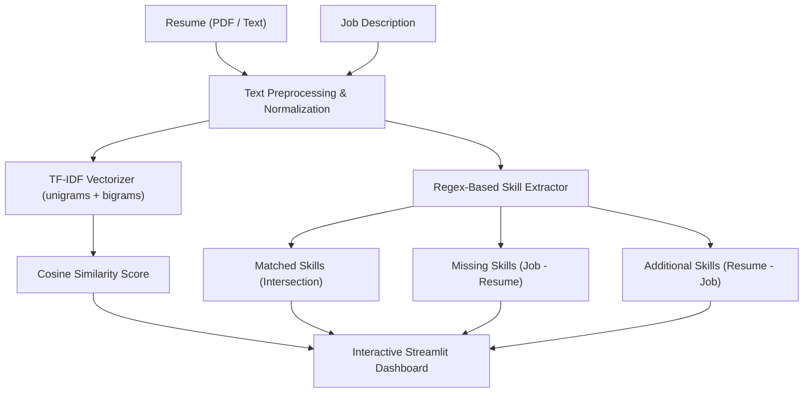

# 🎯 HireLens — NLP Resume to Job Description Matcher

[](https://www.python.org/)
[](https://streamlit.io/)
[](https://scikit-learn.org/)
[](https://render.com)
[](tests/)

**HireLens** is an intelligent, transparent NLP-powered application built with Streamlit that analyzes how well a resume aligns with a targeted job description. It computes semantic text similarity using TF-IDF vectorization and cosine similarity, while concurrently extracting and categorizing technical skills to provide actionable feedback on matched and missing competencies.

---

## 🌟 Key Features

- **Multi-Format Resume Ingestion**: Upload a text-based PDF resume (parsed using `pypdf`) or directly paste raw resume text.
- **TF-IDF & Cosine Similarity**: Uses n-gram (1, 2) TF-IDF representations with sublinear term-frequency scaling to score overall textual alignment.
- **Rule-Based Skill Extraction**: Case-insensitive, boundary-aware regex matching for key software engineering, data science, machine learning, and cloud technologies.
- **Skill Gap Analysis**:
  - ✅ **Matched Skills**: Competencies found in both the resume and the job description.
  - 📌 **Missing Skills**: Requirements specified in the job posting that are absent from the resume.
  - ➕ **Additional Skills**: Extra candidate strengths outside the job posting's scope.
- **Extracted Text Preview**: Inspect the parsed PDF text directly inside the app to ensure data fidelity.
- **Cloud-Ready**: Fully configured for one-click deployment on [Render](https://render.com) with automated port handling and production settings.

---

## 🏗️ Project Architecture

```
Hirelens/
├── .streamlit/
│   └── config.toml          # Streamlit UI theme and production server settings
├── tests/
│   └── test_matcher.py      # Automated unit tests for text cleaning and matching logic
├── app.py                   # Streamlit web interface and user interaction flow
├── matcher.py               # Core NLP engine: TF-IDF, cosine similarity, coverage
├── skills.py                # Skills taxonomy and regex-based extraction dictionary
├── Procfile                 # Process command file for cloud deployment
├── render.yaml              # Render Blueprint specification (Infrastructure as Code)
├── runtime.txt              # Target Python runtime version (3.11.9)
├── pytest.ini               # Pytest configuration file
├── requirements.txt         # Production and development dependencies
└── README.md                # Project documentation
```

### How It Works



---

## 🚀 Quickstart: Running Locally

### 1. Prerequisites
- **Python 3.10, 3.11, or 3.12** installed on your system.
- Git installed.

### 2. Clone the Repository
```bash
git clone https://github.com/adityadhaker-beep/Resume-matcher.git
cd Resume-matcher
```

### 3. Create and Activate a Virtual Environment
- **Windows (PowerShell):**
  ```powershell
  python -m venv .venv
  .venv\Scripts\Activate.ps1
  ```
- **macOS / Linux:**
  ```bash
  python3 -m venv .venv
  source .venv/bin/activate
  ```

### 4. Install Dependencies
```bash
pip install --upgrade pip
pip install -r requirements.txt
```

### 5. Run Automated Tests
```bash
pytest
```
All tests should pass.

### 6. Launch the Streamlit App
```bash
streamlit run app.py
```
Open your browser and navigate to `http://localhost:8501`.

---

## ☁️ Deploying on Render

This repository includes a preconfigured [`render.yaml`](render.yaml), [`Procfile`](Procfile), and [`.streamlit/config.toml`](.streamlit/config.toml) to make deployment on Render seamless.

### Option A: Automatic Blueprint Deployment (Recommended)

1. Push your latest code to your GitHub repository:
   ```bash
   git add .
   git commit -m "Configure Render deployment and documentation"
   git push origin main
   ```
2. Log in to [Render](https://dashboard.render.com/).
3. Click **New +** in the top navigation bar and select **Blueprint**.
4. Connect your GitHub repository (`Resume-matcher`).
5. Render will automatically detect `render.yaml` and configure:
   - **Service Name**: `hirelens-resume-matcher`
   - **Environment**: `Python`
   - **Build Command**: `pip install -r requirements.txt`
   - **Start Command**: `streamlit run app.py --server.port $PORT --server.address 0.0.0.0 --server.headless true`
   - **Plan**: `Free`
6. Click **Apply**. Render will build and deploy your app. Once deployed, Render will provide a live public URL (e.g., `https://hirelens-resume-matcher.onrender.com`).

---

### Option B: Manual Web Service Setup

If you prefer to configure the service manually on the Render dashboard:

1. Go to [Render Dashboard](https://dashboard.render.com/) and click **New +** > **Web Service**.
2. Select **Build and deploy from a Git repository** and connect your `Resume-matcher` repository.
3. Fill in the following settings:
   | Setting | Value |
   |---|---|
   | **Name** | `hirelens-resume-matcher` |
   | **Language / Runtime** | `Python 3` |
   | **Branch** | `main` |
   | **Region** | Choose the closest region (e.g., Oregon, Frankfurt, Singapore) |
   | **Build Command** | `pip install -r requirements.txt` |
   | **Start Command** | `streamlit run app.py --server.port $PORT --server.address 0.0.0.0 --server.headless true` |
   | **Instance Type** | `Free` |

4. Under **Environment Variables**, add:
   | Key | Value |
   |---|---|
   | `PYTHON_VERSION` | `3.11.9` |
   | `STREAMLIT_SERVER_HEADLESS` | `true` |
   | `STREAMLIT_SERVER_ENABLE_CORS` | `false` |
   | `STREAMLIT_SERVER_ENABLE_XSRF_PROTECTION` | `false` |

5. Click **Deploy Web Service**. Within 2–3 minutes, your application will be live.

> [!NOTE]
> On Render's Free tier, services spin down after 15 minutes of inactivity. When a new request arrives, it may take 30–50 seconds to spin back up (cold start).

---

## 🧪 Testing

The test suite validates text normalization, exact and partial skill extraction, identical-document similarity boundaries, and error handling for empty inputs.

To run the tests:
```bash
pytest -v
```

Expected output:
```
tests/test_matcher.py::test_clean_text PASSED
tests/test_matcher.py::test_matching_skills PASSED
tests/test_matcher.py::test_identical_documents PASSED
tests/test_matcher.py::test_empty_input PASSED
============================== 4 passed ==============================
```

---

## ⚠️ Notes & Disclaimer

- **Indicative Tool**: HireLens is an analytical educational tool demonstrating NLP concepts (TF-IDF vector space modeling and dictionary-based entity extraction). Scores do not reflect employability or guarantee hiring outcomes.
- **Scanned PDFs**: Scanned image-only PDFs do not contain embedded text layers and require an OCR preprocessor (e.g., Tesseract). For best results, use digital/text-based PDFs or paste your resume text directly.

---

## 📄 License

This project is open-source under the MIT License.
